# 💰 Finance Controller

Controle financeiro pessoal: receitas, despesas, categorias e um dashboard mensal. API em **ASP.NET Core 8** com arquitetura em camadas, frontend em **React + TypeScript** servido pela própria API, banco **PostgreSQL**, imagem **Docker** e deploy automático com **GitHub Actions** no **Render** + **Neon**.

**URL pública:** preencher após o primeiro deploy.

---

## 🛠️ Stack

| Parte | Tecnologia |
|---|---|
| API | C# 12, ASP.NET Core 8, FluentValidation, AutoMapper, BCrypt |
| Dados | PostgreSQL, Entity Framework Core 9 + Npgsql, migrations do EF Core |
| Autenticação | JWT em cookie `HttpOnly` (`Secure`, `SameSite=Strict`) |
| Frontend | React 19, TypeScript, Vite, React Router; gráficos em SVG feitos à mão |
| Testes | xUnit (unidade e integração com Postgres real), Vitest + Testing Library |
| Entrega | Docker multi-stage, GitHub Actions (CI e deploy), Render (web service free), Neon (Postgres free) |

---

## 🗺️ Diagramas

| | |
|---|---|
| [Arquitetura em camadas](docs/architecture/diagrams/architecture.svg) | Caminho de uma requisição e direção das dependências entre as camadas |
| [Modelo de dados](docs/architecture/diagrams/data-model.svg) | Tabelas, tipos, índices únicos e comportamento das chaves estrangeiras |
| [Fluxo de deploy](docs/architecture/diagrams/deploy-flow.svg) | Do push ao container no Render, e onde cada segredo fica |



Explicação de cada diagrama em [docs/architecture](docs/architecture/README.md#diagramas-do-sistema).

---

## ✨ Funcionalidades

- Cadastro, login e logout. O cadastro cria as categorias padrão (Alimentação, Moradia, Transporte, Saúde, Lazer, Salário, Outros).
- CRUD de categorias, receitas e despesas, sempre restrito ao usuário logado. Nomes de categoria são únicos por usuário; uma categoria com movimentações não pode ser apagada.
- Lista de movimentações com filtro por mês, categoria e tipo.
- Dashboard: saldo, receitas e despesas do mês, gráfico de despesas por categoria e gráfico mês a mês.
- Exclusão da própria conta, que apaga todos os dados do usuário.
- Conta demo opcional (botão "Experimentar com a conta demo"), ligada por configuração.

---

## 📁 Estrutura

```
Finance-Controller-MVC/
├── Finance.Domain/          # Entidades (User, Category, Moviment → Income/Expense), IOwnedEntity, enums
├── Finance.Application/     # Services, validators, DTOs, interfaces (ICurrentUser, repositórios), exceções, mappings
├── Finance.Infrastructure/  # FinanceContext (EF Core + Npgsql, filtro global por usuário), repositórios,
│                            # UnitOfWork, DemoSeeder, Migrations
├── Finance.API/             # Controllers (/api/*), middlewares, /health, autenticação, wwwroot (build do React)
├── Finance.Tests/           # xUnit: Unit/ e Integration/ (Postgres real via TEST_DB_CONNECTION)
├── frontend/                # React + TypeScript + Vite (build vai para Finance.API/wwwroot)
├── docs/                    # Documentação, diagramas, guia de deploy
├── scripts/dev-env.sh       # Ambiente local de testes (Postgres + TEST_DB_CONNECTION)
├── Dockerfile               # Build do frontend, publish da API e imagem final
├── render.yaml              # Blueprint do serviço no Render
└── .github/workflows/       # ci.yml e deploy.yml
```

---

## 🚀 Rodando localmente

### Pré-requisitos

- [.NET 8 SDK](https://dotnet.microsoft.com/download) e a ferramenta `dotnet-ef` 9 (`dotnet tool install -g dotnet-ef --version 9.0.10`)
- [Node.js 22](https://nodejs.org/)
- PostgreSQL 14 ou mais novo, rodando localmente

### 1. Configuração

A API lê tudo de configuração; nada de segredo fica no repositório. Use variáveis de ambiente (ou `dotnet user-secrets` no projeto `Finance.API`):

| Variável | Obrigatória | Descrição |
|---|---|---|
| `Jwt__Key` | sim | Chave de assinatura do JWT, mínimo de 32 caracteres. Sem ela a API não inicia. Gere com `openssl rand -base64 48` |
| `ConnectionStrings__DefaultConnection` | sim | String Npgsql, por exemplo `Host=localhost;Database=finance;Username=postgres;Password=...` |
| `Demo__Enabled` / `Demo__Password` | não | Cria a conta demo ao iniciar |
| `RateLimit__LoginPerMinute` / `RateLimit__RegisterPerHour` | não | Padrões `5` e `10` |

```bash
export Jwt__Key="$(openssl rand -base64 48)"
export ConnectionStrings__DefaultConnection="Host=localhost;Database=finance;Username=postgres;Password=postgres"
```

### 2. Banco de dados

```bash
dotnet ef database update --project Finance.Infrastructure --startup-project Finance.API
```

### 3. API

```bash
dotnet dev-certs https --trust   # uma vez, para o perfil https
dotnet run --project Finance.API --launch-profile https
```

A API sobe em `https://localhost:7113` (Swagger em `/swagger` no ambiente Development). O cookie de sessão é `Secure`, por isso use o perfil `https`.

### 4. Frontend

Modo desenvolvimento, com o proxy do Vite encaminhando `/api` para a API (`VITE_API_PROXY_TARGET` muda o destino):

```bash
cd frontend
npm ci
npm run dev
```

Ou gere o build dentro de `Finance.API/wwwroot` e use só a API, como em produção:

```bash
cd frontend && npm ci && npm run build
```

### Docker

```bash
docker build -t finance-controller .
docker run -p 8080:8080 -e Jwt__Key=... -e ConnectionStrings__DefaultConnection=... finance-controller
```

---

## 🧪 Testes

```bash
# Backend: precisa de um Postgres de teste em TEST_DB_CONNECTION
export TEST_DB_CONNECTION="Host=localhost;Database=finance_test;Username=postgres;Password=postgres"
dotnet test

# Frontend
cd frontend && npm test
```

`scripts/dev-env.sh` (use com `source`) prepara um Postgres local e exporta `TEST_DB_CONNECTION`. No CI, o job `backend` usa um serviço `postgres:16`.

---

## 📚 Endpoints

Todos sob `/api`, em JSON. Exceto registro, login e logout, todos exigem o cookie de sessão.

| Método e rota | Descrição |
|---|---|
| `POST /api/Auth/register` | Cria a conta (10 por hora por IP) |
| `POST /api/Auth/login` | Valida e grava o cookie `jwt` (5 por minuto por IP) |
| `POST /api/Auth/logout` | Remove o cookie |
| `GET /api/Auth/me` | Usuário logado |
| `DELETE /api/Auth/me` | Exclui a conta e todos os dados |
| `GET /api/Category`, `GET /api/Category/{id}` | Lista ou busca categorias |
| `POST /api/Category`, `PUT /api/Category/{id}`, `DELETE /api/Category/{id}` | Cria, altera ou remove categoria |
| `GET`, `POST /api/Income`; `GET`, `PUT`, `DELETE /api/Income/{id}` | Receitas |
| `GET`, `POST /api/Expense`; `GET`, `PUT`, `DELETE /api/Expense/{id}` | Despesas |
| `GET /api/Movement?year=&month=&categoryId=&type=` | Movimentações filtradas |
| `GET /api/Summary?year=&month=` | Totais e despesas por categoria do mês |
| `GET /api/Summary/series?months=12` | Série mês a mês |
| `GET /health` | Liveness (não consulta o banco) |

---

## 🔐 Segurança

- **Isolamento por usuário:** `Category` e `Moviment` têm `UserId`, e o `FinanceContext` aplica um filtro global (`HasQueryFilter`) com o usuário do token; nenhum dado de outra conta aparece em consultas.
- **Sessão:** JWT de 8 horas em cookie `HttpOnly`, `Secure`, `SameSite=Strict`; a chave vem só de `Jwt__Key`.
- **Senhas** com BCrypt; o cadastro não aceita papel (role) vindo do cliente.
- **Rate limit** por IP: login 5/min, cadastro 10/h. A API aceita apenas JSON em escritas sob `/api` (415 caso contrário).
- HSTS e redirecionamento para HTTPS fora de Development; `X-Forwarded-*` confiável porque o app só é exposto pelo proxy do Render.
- **Limitações conhecidas:** não há verificação de e-mail nem recuperação de senha.

---

## ☁️ Deploy

Push na `main` → CI verde → workflow `Deploy` aplica as migrations no Neon (conexão direta), chama o Deploy Hook do Render e espera `/health`. Passo a passo, variáveis e segredos em [docs/devops/DEPLOY.md](docs/devops/DEPLOY.md).

---

## 📖 Documentação

- [docs/](docs/README.md) — índice
- [Arquitetura e diagramas](docs/architecture/README.md)
- [Roadmap](docs/Roadmap.md)
- [Deploy](docs/devops/DEPLOY.md)
- [Testes](docs/testing/README.md)
