# 🏗️ Arquitetura & Design

Documentação sobre padrões arquiteturais, princípios de design e estrutura do projeto Finance-Controller-MVC.

---

## 📚 Documentos

### [SOLID Principles](SOLID-Principles.md)
**Status**: ✅ Completo  
**Última Atualização**: 26/04/2026

Documentação abrangente dos 5 princípios SOLID aplicados ao Finance-Controller-MVC:

- **S** — Single Responsibility Principle (Responsabilidade Única)
- **O** — Open/Closed Principle (Aberto/Fechado)
- **L** — Liskov Substitution Principle (Substituição de Liskov)
- **I** — Interface Segregation Principle (Segregação de Interface)
- **D** — Dependency Inversion Principle (Inversão de Dependência)

Contém:
- ✅ Definições claras
- ✅ Exemplos do código real
- ✅ Analogias do domínio financeiro
- ✅ Anti-patterns
- ✅ Validação com quizzes
- ✅ Melhorias futuras

**Para quem?** Todos no time devem ler para entender a base arquitetural.

---

### [Diagramas do sistema](#diagramas-do-sistema)
**Status**: ✅ Completo
**Última Atualização**: 19/11/2026

Arquitetura em camadas, modelo de dados e fluxo de deploy, em `diagrams/` (`.svg` para leitura no GitHub, `.html` autocontido como fonte).

---

### Design Patterns (Planejado)
**Status**: 🔄 Planejado

Padrões de design utilizados:
- Repository Pattern
- Unit of Work Pattern
- Specification Pattern (futuro)
- Factory Pattern (futuro)
- Strategy Pattern (futuro)

---

## 🚀 Quick Start

Se é novo no projeto:

1. **Leia**: [SOLID Principles](SOLID-Principles.md) (30 min)
2. **Entenda**: Quais princípios aplicamos em cada camada
3. **Explore**: O código seguindo a documentação
4. **Implemente**: Novos features mantendo os padrões

---

## Diagramas do sistema

Os três diagramas foram feitos com a skill `diagram-design`, usando as cores e a fonte do produto (cobalto, ocre e glaze do `DESIGN.md`, Public Sans). Cada um tem uma versão `.html` autocontida (abra no navegador; no celular o diagrama rola na horizontal) e uma exportação `.svg`.

### Arquitetura em camadas

Uma requisição sai do navegador, passa pelo proxy do Render (TLS e `X-Forwarded-*`) e entra no pipeline de middlewares da `Finance.API`, na ordem de `Program.cs`: ForwardedHeaders, cabeçalhos de segurança, HSTS e redirecionamento HTTPS (fora de Development), ExceptionHandling, arquivos estáticos, RequireJson, Routing, RateLimiter, Authentication (JWT lido do cookie `jwt`) e Authorization. Rotas `/api/*` chegam aos controllers, que chamam os services da `Finance.Application`; os services usam interfaces de repositório que a `Finance.Infrastructure` implementa sobre o `FinanceContext` (EF Core + Npgsql). É no `FinanceContext` que mora o isolamento por usuário: um filtro global (`HasQueryFilter`) em `Category` e `Moviment` compara `UserId` com o `ICurrentUser` da requisição. As demais rotas `GET` caem nos arquivos do build do React em `wwwroot` ou no fallback para `index.html`. Todas as camadas dependem de `Finance.Domain`, que não depende de nenhuma. [HTML](diagrams/architecture.html) · [SVG](diagrams/architecture.svg)

### Modelo de dados

São três tabelas no PostgreSQL. `Income` e `Expense` herdam da classe abstrata `Moviment` e ficam juntas na tabela `Moviments` (TPH), separadas pela coluna `Type` (1 = Income, 2 = Expense). Valores são `numeric(18,2)` e datas são `date`. Há índice único em `User(Email)` e em `Categories(UserId, Name)`. Apagar um usuário apaga em cascata as categorias e os movimentos dele (é assim que funciona a exclusão de conta); a chave de `Moviments.CategoryId` é `NO ACTION`, e o service responde 409 ao tentar apagar uma categoria com movimentos. [HTML](diagrams/data-model.html) · [SVG](diagrams/data-model.svg)

### Fluxo de deploy

Todo push e todo PR rodam o workflow `CI` (jobs `backend` com um Postgres de serviço, `frontend`, e `docker`, que só confere o build da imagem). Quando o CI de um push na branch padrão deste repositório (hoje `master`) termina verde (ou numa execução manual a partir dela), o workflow `Deploy` gera o bundle de migrations do EF Core, aplica-o no Neon pela conexão **direta** (`DATABASE_URL_DIRECT`), chama o Deploy Hook do Render (`RENDER_DEPLOY_HOOK_URL`) e consulta `APP_URL/health` até receber `ok` com o SHA do commit publicado. O Render constrói a imagem a partir do `Dockerfile` e o app conecta no Neon pela conexão **pooled**. Os segredos do deploy ficam no environment `production` do GitHub; os do app (`Jwt__Key`, `ConnectionStrings__DefaultConnection`, `Demo__Password`) ficam nas variáveis do serviço no Render. Detalhes em [DEPLOY.md](../devops/DEPLOY.md). [HTML](diagrams/deploy-flow.html) · [SVG](diagrams/deploy-flow.svg)

### Dependências entre projetos

| Projeto | Referencia |
|---|---|
| `Finance.Domain` | nenhum |
| `Finance.Application` | Domain |
| `Finance.Infrastructure` | Application, Domain (implementa as interfaces da Application) |
| `Finance.API` | Application, Infrastructure, Domain (raiz de composição: registra tudo no DI em `Program.cs`) |
| `Finance.Tests` | API, Application, Infrastructure |

---

## 🎯 Princípios em Ação

### Single Responsibility (SRP)
- Repository: APENAS acesso a dados
- Service: APENAS lógica de negócio
- Controller: APENAS HTTP protocol

### Open/Closed (OCP)
- BaseRepository: genérico, extensível via classes concretas
- BaseService: virtual methods, override em subclasses

### Liskov Substitution (LSP)
- Trocar CategoryService por ExpenseService sem quebras
- UserService com criptografia ainda respeita contrato

### Interface Segregation (ISP)
- IBaseService é bem segregada
- Futuro: IReadOnlyService para AuditService

### Dependency Inversion (DIP)
- Controllers recebem IService, não Service
- Services recebem IRepository, não Repository concretos
- DI Container em Program.cs gerencia tudo

---

## 📝 Checklist para Novos Features

Ao implementar novo feature:

- [ ] Respeita SRP? (Cada classe tem uma responsabilidade)
- [ ] É aberto para extensão? (Não modifica código existente)
- [ ] Substitui tipos sem surpresas? (LSP válido)
- [ ] Interfaces são pequenas? (ISP respeitado)
- [ ] Depende de abstrações? (DIP válido)
- [ ] Tem testes? (Coverage 80%+)
- [ ] Documentado? (Código + comments)

---

## 🔗 Links Úteis

- [SOLID Principles](SOLID-Principles.md) — Arquivo completo
- [Roadmap](../Roadmap.md) — Plano geral
- [GitHub Repo](https://github.com/jeferson-santos/Finance-Controller-MVC) — Código-fonte

---

**Mantido por**: Jeferson Santos  
**Última Atualização**: 19 de Novembro de 2026
