# 🚀 DevOps — CI/CD, Deploy & Infraestrutura

Documentação sobre pipeline de deploy, containerização e infraestrutura.

---

## 📚 Documentos

### [DEPLOY.md](DEPLOY.md)
**Status**: ✅ Completo (19/11/2026)

Passo a passo de produção: Neon (Postgres), Render (web service Docker), segredos e variáveis no GitHub e no Render, primeiro deploy, verificação, rotação de segredos e limitações dos planos gratuitos.

### [Diagrama do fluxo de deploy](../architecture/README.md#fluxo-de-deploy)
**Status**: ✅ Completo (19/11/2026)



---

## 🏗️ Infraestrutura atual

- **CI** (`.github/workflows/ci.yml`, todo push e PR): `backend` (build e `dotnet test` com serviço `postgres:16`), `frontend` (`npm ci`, lint, testes, build) e `docker` (build da imagem, sem push).
- **Deploy** (`.github/workflows/deploy.yml`): roda quando o CI de um push na branch padrão (hoje `master`) deste repositório termina verde, ou manualmente a partir dela. Gera o bundle de migrations do EF Core, aplica no Neon pela conexão direta, chama o Deploy Hook do Render (com `ref=<sha>`) e espera `/health` responder `ok` com a versão (SHA) esperada.
- **Imagem** (`Dockerfile`): build do React, publish da API com o build em `wwwroot`, runtime `aspnet:8.0` sem root na porta 8080.
- **Hospedagem**: Render (web service free, `render.yaml`, auto deploy desligado) e Neon (Postgres free; conexão pooled para o app, direta para migrations).

---

## 🎯 Planilha de DevOps

| Componente | Status | Sprint |
|-----------|--------|--------|
| GitHub Actions (CI) | ✅ Pronto | 9 |
| Docker API + frontend | ✅ Pronto | 9 |
| Workflow de deploy | ✅ Pronto | 9 |
| Primeiro deploy em produção | ⏳ Pendente (contas Render/Neon e segredos) | 9 |
| Docker Compose local | 🔄 Não planejado por ora | - |
| Monitoring / Alertas | 🔄 Planejado | 10 |

---

## ⚡ Quick Reference

### Local Docker
```bash
docker build -t finance-controller .
docker run -p 8080:8080 \
  -e Jwt__Key="$(openssl rand -base64 48)" \
  -e ConnectionStrings__DefaultConnection="Host=host.docker.internal;Database=finance;Username=postgres;Password=postgres" \
  finance-controller
```

### Validar os workflows
```bash
actionlint .github/workflows/*.yml
```

---

## 🤔 Troubleshooting

### Problema: "Imagem Docker muito grande"
→ Use multi-stage builds
→ Remova files desnecessários
→ Use .dockerignore

### Problema: "Build GitHub Actions demora"
→ Cache dependências NuGet
→ Use layers do Docker
→ Considere matrix builds

### Problema: "Prod diferente de local"
→ Rode a imagem Docker localmente (acima)
→ Environment variables para config
→ Versionamento de imagens

---

## 📚 Leitura Recomendada

1. **GitHub Actions**: https://docs.github.com/en/actions
2. **Docker**: https://docs.docker.com/
3. **Docker Compose**: https://docs.docker.com/compose/
4. **Microsoft Deploy .NET**: https://docs.microsoft.com/en-us/dotnet/core/docker/build-container

---

## 🎓 Roadmap de DevOps

### Sprint 9: CI/CD & Docker
- [x] Criar Dockerfile
- [x] GitHub Actions pipeline
- [x] Testes em CI
- [x] Workflow de deploy (migrations, Deploy Hook, health check)
- [ ] Primeiro deploy (depende da configuração das contas)

### Sprint 10: Produção
- [x] SSL/HTTPS (terminado no proxy do Render; HSTS no app)
- [ ] Monitoring & Alertas
- [ ] Logs estruturados
- [ ] Backup strategy

---

**Última Atualização**: 19 de Novembro de 2026
